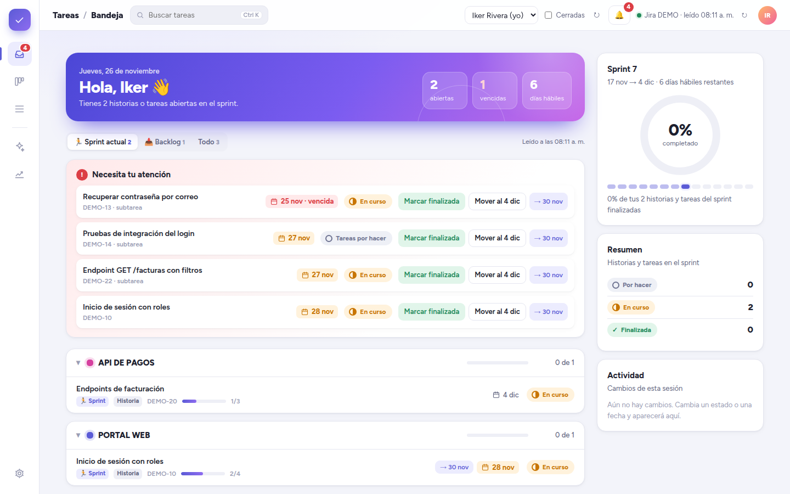
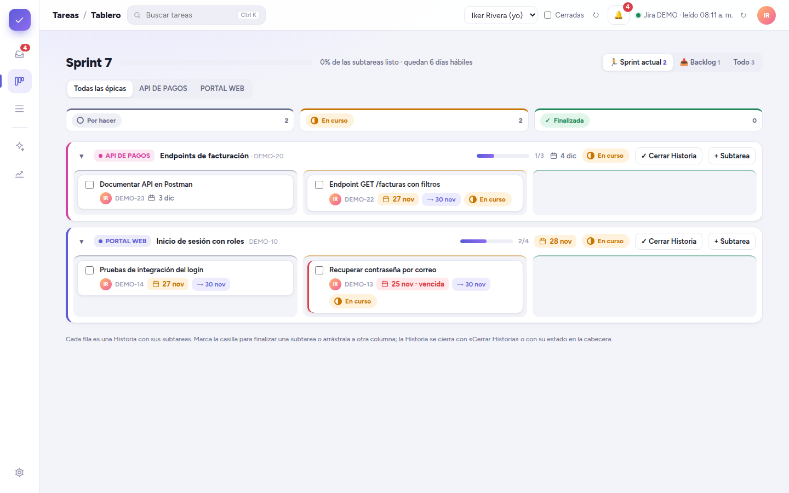

# Tareas IA → Jira

**Español** · [English](README.en.md)

[](https://github.com/riveoca/tareas/actions/workflows/ci.yml)


[](LICENSE)

App web local para registrar en **Jira Cloud** el trabajo del equipo y seguir el avance del sprint.

- **Tareas:** describes con tus palabras el trabajo realizado, o cargas archivos de registro, y una IA
  (Claude u Ollama en local) lo desglosa en épicas y tareas listas para Jira. Las revisas en una tabla
  y las subes con un botón.
- **Avance del sprint:** informe de trabajo completado del equipo y personal, y tareas subidas por día.
  Los datos se leen de Jira y los fines de semana no aparecen en el eje.

Hecha con FastAPI, SQLite y una única página HTML sin dependencias de front.





*Capturas con datos de ejemplo.*

## Requisitos

- Python 3.11+
- Una cuenta de Jira Cloud con un [token de API](https://id.atlassian.com/manage-profile/security/api-tokens)
- Al menos una IA:
  - [Claude Code](https://claude.com/claude-code) con sesión iniciada: usa tu cuenta de Claude, sin API key
  - una API key de Anthropic
  - [Ollama](https://ollama.com) en local (se recomienda un modelo de 7B o más)

## Instalación

```bash
python3 -m venv .venv
.venv/bin/pip install -r requirements.txt
cp .env.example .env      # y rellénalo
```

Variables principales de `.env` (todas están explicadas en `.env.example`):

| Variable | Para qué |
|---|---|
| `JIRA_URL`, `JIRA_EMAIL`, `JIRA_API_TOKEN`, `JIRA_PROJECT_KEY` | Conexión con Jira |
| `LLM_PROVIDER` | IA por defecto: `claude_code`, `claude` u `ollama` (se puede cambiar en la app) |
| `ANTHROPIC_API_KEY`, `CLAUDE_MODEL` | Solo para `claude` (API de Anthropic) |
| `OLLAMA_URL`, `OLLAMA_MODEL` | Solo para `ollama` |
| `JIRA_STORY_POINTS_FIELD`, `JIRA_START_DATE_FIELD` | Opcionales; si se dejan vacíos se detectan por nombre |

## Uso

```bash
./tareas check    # comprueba la conexión con Jira, Claude y Ollama
./tareas          # abre la app en http://127.0.0.1:8765
```

### Inicio automático

`inicio.sh` levanta la app en segundo plano (si no está corriendo) y abre una ventana de Chrome con la app y las
pestañas de `pestanas.txt` (una URL por línea). Para que se ejecute al iniciar sesión en GNOME, se crea
`~/.config/autostart/tareas.desktop` con `Exec=<ruta del proyecto>/inicio.sh`; se desactiva borrando ese archivo
o en «Aplicaciones al inicio». El registro de cada arranque queda en `inicio.log`.

### Tareas

1. En **⚙️ Configuración** se eligen el responsable, el sprint y las fechas que reciben las tareas nuevas.
   Si las fechas se dejan vacías, cada tarea empieza hoy y termina el último día del mes.
2. **Nuevo desglose** tiene tres modos:
   - ✍️ **Escribir:** describes lo que hiciste. Si nombras a alguien del equipo, la tarea se le asigna a esa persona.
   - 📄 **Subir .txt:** archivos `.txt`, `.md`, `.log`, `.csv` o `.json` de hasta 2 MB.
   - 📋 **Lista rápida:** una tarea por línea, sin IA; una línea `# PROYECTO` elige la épica.
   Con la metodología Planner → Historia → subtareas, la IA recibe las Historias abiertas de Jira (las tareas del
   Planner) con sus subtareas y cuelga cada trabajo como **subtarea** de su Historia (1 punto cada una; el sprint es el de la
   Historia). Lo que no encaja en ninguna queda «Sin Historia» y se sube como tarea suelta de la épica. Si el texto
   dice que algo ya se hizo, la tarea se marca «Hecha» y se sube como Finalizada; y si ese trabajo ya existía como
   subtarea planificada, no se duplica: la app ofrece **marcarla como finalizada** en Jira.
3. La **lista de tareas** las agrupa por épica y muestra título, responsable, sprint, fechas y su clave de Jira (o
   «Pendiente»); se filtra por épica, persona o estado. Al pulsar una tarea se abre un panel lateral donde se editan
   título, épica, responsable, sprint, fechas, puntos, tipo, prioridad, etiquetas y descripción, y desde el que se
   sube o se elimina. Con las casillas se aplican cambios a varias tareas, se suben o se eliminan. Los cambios se
   guardan automáticamente.
4. **Subir a Jira** crea las épicas y sus tareas y las mueve al sprint. Las tareas que ya tienen clave
   (p. ej. `PRJ-123`) se actualizan en lugar de duplicarse. Eliminar una tarea en la app no la borra en Jira.

Criterios del desglose:
- Cada tarea es un entregable con sentido propio (1 story point, de unas horas a un día). Los pasos intermedios
  van como viñetas en la descripción.
- Las épicas son los proyectos. Si el proyecto ya existe como épica en Jira, se usa esa.
- Los títulos siguen el formato `PROYECTO - descripción - info adicional`, donde el proyecto es el nombre de la épica.
- En Jira, cada tarea se crea con su épica como padre y sin etiquetas.

### Avance del sprint

Se abre desde la pestaña **📈 Avance del sprint** o en `http://127.0.0.1:8765/#sprint`. Arriba se eligen el
sprint y la persona (por defecto, el usuario de Jira conectado).

- **Informe de trabajo completado:** es el mismo informe de Jira, con todo el equipo.
  - **Alcance del trabajo (rojo):** puntos de las tareas del sprint.
  - **Trabajo completado (verde):** puntos de las tareas cerradas.
  - **Directriz (gris):** ritmo ideal, de 0 al inicio hasta el alcance actual al final del sprint.
  - Las líneas cambian en escalón en el instante de cada evento, y desde «Hoy» el alcance se proyecta punteado.
  - Debajo, la **tabla de actividad** lista cada evento con su variación.
- **Mi trabajo completado:** el mismo informe, solo con las tareas asignadas a la persona elegida.
- **Tareas subidas:** tareas creadas en el sprint por día hábil, en acumulado y por día.

Eje de tiempo:
- Va del inicio al fin previsto del sprint. Si el sprint sigue abierto después de esa fecha, se alarga hasta
  hoy (o hasta su cierre) y se marca el fin previsto.
- Sábados y domingos se quitan; lo ocurrido en fin de semana se muestra al empezar el lunes.

Los datos se leen de Jira al abrir la vista, al cambiar de sprint o al pulsar ↻.

### Desempeño histórico individual

Apartado plegado al final de la vista del sprint. Solo se pide a Jira al desplegarlo, porque recorre todas las
incidencias del proyecto (unos 10 s); el servidor guarda el resultado 10 minutos y ↻ lo vuelve a leer.

- Se elige la persona (por defecto, el usuario de Jira), la medida (puntos o tareas) y el periodo (todo el
  histórico o los últimos 6 / 3 sprints cerrados).
- Cada incidencia cerrada (sin épicas) cuenta en el último sprint en que estuvo y para su responsable actual; si
  nunca tuvo sprint, en el sprint cuyo periodo contiene su fecha de resolución.
- Para que llevar más o menos sprints no dé ventaja, toda la comparación usa solo los sprints cerrados en que estaba
  la persona elegida (dentro del periodo), y se compara la media por sprint, no el total acumulado. De cada persona
  cuentan los de esos sprints en que estaba en el equipo (de su primer a su último sprint con algo cerrado, con los
  sprints a 0 intermedios); la tabla indica cuántos sprints tiene en común. El sprint en curso no entra en las medias.
- «vs resto» compara la media de la persona con la media por persona de los demás en esos mismos sprints, y
  «% del equipo» es su parte de lo cerrado en esos sprints.
- Muestra indicadores, una gráfica por sprint (persona frente a la media y el rango del resto), un ranking por media
  y una tabla del equipo.
- **Tendencia:** media de los últimos sprints frente a la de los anteriores (3 y 3, o menos si hay pocos; hacen
  falta 4 sprints), junto a la del resto del equipo en esos sprints.
- **Reparto por proyecto:** por cada épica, qué % del trabajo de la persona va a ella frente al % del equipo, y
  qué parte del proyecto hizo ella. Las subtareas y las tareas sin épica cuentan como «Sin épica».

### Limitaciones

- El informe de trabajo completado usa la API interna con la que Jira dibuja su propio informe
  (`/rest/greenhopper/1.0/rapid/charts/scopechangeburndownchart.json`). No es una API pública, así que puede
  cambiar sin aviso.
- El informe personal cuenta cada tarea para su responsable actual; no refleja reasignaciones durante el sprint.
- El selector de sprint muestra los sprints activos y futuros.
- El desempeño histórico atribuye todo a quien tiene la tarea asignada hoy, y un sprint con muy poco trabajo de
  alguien puede alargar su periodo en el equipo; con menos de 3 sprints se marca «pocos datos».
- Si Jira rechaza un campo opcional (prioridad, story points, fecha de inicio) porque no está en la pantalla del
  proyecto, la tarea se crea sin él y se avisa en el resultado.

### Mis tareas

La app tiene un menú lateral con cinco secciones: tres vistas de **Mis tareas** (Bandeja, Tablero y Tabla),
**Desglose con IA** y **Avance del sprint** (ambas con un encabezado que resume el plan o el sprint); abajo, el cambio
entre modo claro y oscuro. El logo lleva a la Bandeja y el avatar vuelve a las tareas propias. Las tres vistas de Mis
tareas muestran las Historias y tareas de Jira asignadas a la persona elegida arriba (por defecto, el usuario
conectado), con un selector de alcance: **🏃 Sprint actual**, **📥 Backlog** o **Todo**.

- **Bandeja**: saludo con abiertas, vencidas y días hábiles que quedan del sprint; el bloque **Necesita tu atención**
  (vencidas y por vencer, con «Marcar finalizada» y «Mover al» fin del sprint); las épicas plegables con su avance
  (las finalizadas se esconden en «Ver N finalizadas»); y a la derecha el anillo del sprint, el resumen por estado
  y la actividad de la sesión.
- **Tablero**: columnas Por hacer / En curso / Finalizada; arrastrar una tarjeta cambia su estado en Jira.
- **Tabla**: fichas para filtrar (abiertas, vencidas, por vencer, finalizadas, todas), filas agrupadas por épica.

En todas, la píldora de estado abre un menú para cambiarlo y al pulsar una tarea se abre el **panel de detalle**:
título, estado, asignado, inicio, cierre, épica o Historia, descripción y, en una Historia, sus subtareas (con
casilla para cerrarlas o reabrirlas y un campo para crear otra). **Guardar cambios** escribe directamente en Jira:

- Las subtareas solo se pueden editar si las creó el usuario; las demás se abren en solo lectura (🔒).
- Al cambiar una Historia se avisa antes, porque es el espejo de una tarea del Planner.
- Si la incidencia cambió en Jira desde que se cargó, se pregunta qué versión conservar.
- Al cerrar una Historia con subtareas abiertas se ofrece cerrarlas también.

**Fechas del sprint y del backlog.** Solo las fechas de lo que está en el sprint activo son urgentes: «Vencidas» y
«Por vencer» (en rojo y naranja, en la Bandeja, las alertas y el número del menú) cuentan solo eso. En el backlog la
fecha es orientativa: se muestra en gris («· pasada» si ya pasó) y lo atrasado va al grupo de alertas «Backlog con
fecha pasada». Cada tarea lleva su etiqueta 🏃 Sprint o 📥 Backlog. En lo vencido o por vencer aparece el botón
rápido **→ fin de mes** («→ 31 oct»), que cambia el cierre al último día del mes actual; el panel de detalle tiene
un botón «Fin de mes» junto al campo de cierre.

El buscador de arriba (**Ctrl+K**) lleva a la Tabla filtrada. La campana 🔔 abre el panel lateral de **alertas**
(vencidas, por vencer, Historias pendientes, listas para cerrar, sin subtareas y fechas incoherentes); el número
rojo del menú son las vencidas y por vencer del usuario conectado. Los títulos se muestran sin el prefijo del
proyecto en mayúsculas («PROYECTO/CLIENTE - …»), porque la épica ya va en su etiqueta de color.

## Estructura

| Archivo | Contenido |
|---|---|
| `tareas_app/llm.py` | Prompt del desglose, llamadas a cada IA y construcción del plan (épicas, títulos, responsables, fechas) |
| `tareas_app/jira.py` | Cliente de Jira: metadatos, creación y actualización de incidencias, datos de las gráficas del sprint |
| `tareas_app/models.py` | Modelos de datos: salida de la IA y plan de la app |
| `tareas_app/server.py` | API (FastAPI) |
| `tareas_app/store.py` | Persistencia en SQLite (`tareas.db`) |
| `tareas_app/config.py` | Lectura de `.env` |
| `tareas_app/static/index.html` | Interfaz completa: vistas de tareas y del sprint, gráficas en SVG |

| Endpoint | Descripción |
|---|---|
| `GET /api/config` | Datos del proyecto en Jira: equipo, tipos, sprints, épicas y usuario conectado |
| `GET /api/state` · `PUT /api/plan` · `PUT /api/defaults` | Plan y configuración guardados |
| `POST /api/breakdown/text` · `POST /api/breakdown/file` | Desglose con IA |
| `POST /api/push` | Subida a Jira |
| `GET /api/sprint/{id}/issues` | Tareas del sprint con fecha de creación y responsable |
| `GET /api/sprint/{id}/burnup?assignee=` | Informe de trabajo completado (del equipo o de una persona) |
| `GET /api/performance?refresh=` | Puntos y tareas cerradas por persona y sprint en todo el histórico (caché de 10 min) |
| `GET /api/mywork?account_id=&done=` | Historias y subtareas de una persona, con épicas y avance |
| `PATCH /api/issues/{key}` | Edita una incidencia en Jira (403 si es una subtarea ajena, 409 si cambió desde que se cargó) |
| `POST /api/issues/{key}/status` | Cambia el estado (por hacer, en curso, finalizada) |
| `POST /api/issues/{key}/subtasks` | Crea una subtarea en una Historia |

## Desarrollo

- El servidor no se recarga solo: tras cambiar código Python hay que reiniciarlo.
- `.env` (token de Jira) y `tareas.db` (datos locales) están en `.gitignore`.

## Licencia

[MIT](LICENSE)
